<!-- ┌───────────────────────────────────────────────────────────────────────┐
     │ Todas las tarjetas son SVG generadas por scripts/ (Python) y se       │
     │ vuelven a dibujar solas cada día con .github/workflows/update-profile │
     │ Para cambiar tu CV edita SOLO data/profile.json y haz commit.         │
     └───────────────────────────────────────────────────────────────────────┘ -->

 

<h3><code>alex@github ~ $ whoami</code></h3>

<table>
<tr>
<td valign="top"></td>
<td valign="top"></td>
</tr>
</table>

 

<h3><code>alex@github ~/carrera $ git log --graph</code></h3>

 
 

<h3><code>alex@github ~ $ ls -la ~/proyectos</code></h3>

 
 

<h3><code>alex@github ~ $ ./contribuciones.sh</code></h3>

  

 
 

<h3><code>alex@github ~ $ ./contacto.sh</code></h3>

<b>Ciberseguridad · Redes · Soporte TI</b> — abierto a prácticas pre-profesionales y roles junior SOC / NOC

<!-- Si quieres un botón de correo, borra estas marcas de comentario y pon tu correo:

-->

 

⚙️ Tarjetas generadas con Python + GitHub Actions · se actualizan solas cada día

